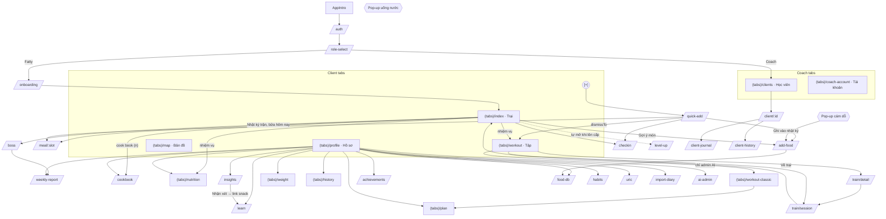

# FitJourney: thiết kế màn hình hiện tại

> Mô tả những gì **code đang làm** ở bản **0.21.0** (`APP_VERSION` trong `src/utils/buildInfo.ts`), không phải bản kế hoạch.
> Thiết kế gốc nằm ở `Design/v4-fitquest/` (PNG), `Design/screens.html`, `Design/screens/`, `Design/design-system.html`. Đó là kế hoạch cũ; những chỗ khác với v4 được ghi chú ở từng màn và ở mục 4.
> Nguồn: `app/**`, `src/components/quest/**`, `src/screens/*`, `src/theme/quest.ts`, các bảng chữ `src/**/strings.ts` (chữ trích ở đây là bản tiếng Việt). Chỗ nào chưa chắc chắn có ghi "(chưa kiểm chứng)".
> Ngày viết: 2026-11-02.

> **Cập nhật 0.34.0 (redesign GĐ0–6, `Design/uiux-proposal/`)**: mục 0 dưới đây là điều hướng hiện tại. Các mục 1–4 còn tả bản 0.21.0, giữ để đối chiếu; chỗ nào khác mục 0 thì theo mục 0.

## 0. Điều hướng hiện tại (0.34.0)

- **Thanh tab 5 ô**: Trại (`(tabs)/index`) · Tập (`(tabs)/workout`) · **(+)** (`/quick-add`) · Hành trình (`(tabs)/map`) · Hồ sơ (`(tabs)/profile`). Coach: Học viên (`clients`) · Tài khoản (`coach-account`).
- **Trại**: chip ngày "📅 Hôm nay ▾" (sheet chọn ngày, dùng chung cho mọi màn ghi), thẻ "Hôm nay" + thanh boss tuần (sheet Boss tuần → "Xem cả tuần" = Nhật ký › Tuần), 3 ô 1 chạm (Chụp món → `/add-food`, +250 ml + Hoàn tác, Tập N′ → `/train/session`), 7 vòng nhiệm vụ (sheet), Bữa kế tiếp, thẻ check-in buổi tối, thẻ "Tổng kết tuần" thứ Hai, dòng thời gian ngắn → Nhật ký.
- **(+)**: Chụp món · Nói / gõ món · Món đã lưu (→ `/add-food`, 2 bước, "Lưu bữa"), Ăn lại, nước (giữ để nhập số khác), cân (sheet stepper), Cảm giác (`/checkin`), Tập khác (sheet).
- **Tập**: thẻ hôm nay + "Bắt đầu · giọng HLV" (`/train/session`, thoát hỏi bằng hộp trong app), nhóm A / B / C / Bài kế hoạch, "Thêm / bớt bài" (sheet), dòng bài → `/train/detail`, "Tập khác" (sheet: chạy, bơi, ảnh đồng hồ, ✨ AI ước tính kcal), "Tuần này", "Sửa / xoá buổi đã ghi" → `/workout-classic`.
- **Hành trình**: boss chặng lớn, nút boss theo vùng → sheet (kỹ năng, khẩu chiến, nhật ký sát thương); chip "Cân nặng" → `/weight` (một biểu đồ, lần cân xoá + Hoàn tác, + mở sheet cân).
- **Nhật ký** (`/journal?tab=day|week|month`, `focus=<nhiệm vụ>`): Ngày (số, thâm hụt, nước, dòng thời gian, bảng dinh dưỡng, bảng bữa) · Tuần (dải tuần, boss tuần + log 7 ngày, "Tổng kết tuần (AI)" → `/weekly-report`) · Tháng (lịch, "Phân tích sâu ▸" → `/insights`, "Cân nặng" → `/weight`). Đường cũ: `/history` → Tháng, `/boss` vẫn mở trang boss (có "Xem cả tuần"), `/today-classic` → Trại.
- **Cook book** (`/cookbook`): tìm + sheet lọc, "Món của tôi | 🎉 Cheat day", lưới ảnh, "✨ Gợi ý món mới" (sheet); món → `/recipe/[id]`; `/cheat-day` (thèm gì, chip vị trí, quán + ⓘ, đã lưu, lịch sử: xoá / xoá hết đều có Hoàn tác); `/food-db`.
- **Hồ sơ**: thẻ danh tính, 3 số, lối tắt Nhật ký / Thành tích / Cook book; Cài đặt: Mục tiêu & kế hoạch (`/plan`, → `/plan-menu`), Nước uống, Giới hạn & 16:8 (→ `/uric`), Nhắc nhở & cám dỗ, AI (→ `/ai-admin` chỉ admin), Coach & tài khoản (ngôn ngữ, coach, Nhập nhật ký → `/import-diary`, Đăng xuất) = `/settings/*`; Thêm: Thói quen, Kiến thức, Dinh dưỡng (`/nutrition`), Lịch sử, Tổng kết tuần (AI), Phân tích.
- **Hộp xác nhận** chỉ còn 2: xoá nhật ký trước ngày và đăng xuất (cộng "Thoát buổi tập?" khi đang tập). Mọi xoá khác làm ngay với toast "Hoàn tác"; lỗi nhập là dòng đỏ, quyền / coach cập nhật kế hoạch là toast.

---

## 1. Tổng quan điều hướng

### 1.1 Khởi động và cổng vào (`app/_layout.tsx`)

1. `AppIntro` (logo, tối thiểu 1,2 s) hiện cho tới khi: auth đã khởi tạo, đã kiểm tra hết hạn phiên (**24 giờ không mở app thì phải đăng nhập lại**), đã kéo hồ sơ và khôi phục nhật ký từ cloud (chờ tối đa 6 s, sau đó app vẫn mở, việc khôi phục chạy nền), và font Chakra Petch đã tải xong (lỗi font thì dùng font hệ thống).
2. Chuyển hướng:
   - chưa có phiên → `/auth`
   - có phiên nhưng chưa chọn vai trò → `/role-select`
   - đang ở auth/role-select mà đã đủ điều kiện → `/(tabs)/clients` (coach) hoặc `/(tabs)` (client)
   - client chưa làm onboarding → `(tabs)/_layout.tsx` đưa sang `/onboarding`
3. Lớp phủ toàn cục, chỉ dành cho **client** đã đăng nhập (xem mục 3.9):
   - `WeeklyReportAutoRefresh`: tự viết lại tổng kết tuần bằng AI (debounce) khi dữ liệu tuần thay đổi
   - `TemptationHost`: pop-up thử thách cám dỗ
   - `WaterReminderHost`: pop-up giờ uống nước
4. Stack: mọi màn `headerShown: false`, mặc định `slide_from_right` 280 ms.
   - `onboarding`, `role-select`, `add-food`: modal trượt từ dưới
   - `quick-add`, `checkin`, `level-up`: `transparentModal` + fade (dạng bottom sheet `QuestSheet` trên nền mờ)
   - `train/session`: `fade_from_bottom`, tắt cử chỉ vuốt lui
   - `auth`: fade

### 1.2 Tab (`app/(tabs)/_layout.tsx` + `QuestTabBar`)

Thanh tab là `QuestTabBar` tự vẽ, nổi ở đáy màn hình. Nó **chỉ hiện các route có trong bảng `TABS`** của chính nó, nên một số route vẫn là "tab" của expo-router nhưng không bao giờ có nút trên thanh.

| Route (file) | Trên thanh tab | Client | Coach | Ghi chú |
|---|---|---|---|---|
| `index` (Trại) | Có, icon `camp` | hiện | ẩn | tab mặc định của client |
| `workout` (Tập) | Có, icon `dumbbell` | hiện | ẩn | |
| **[+] Ghi nhanh** | Nút kim cương vàng ở giữa | hiện | **không có** | mở `/quick-add` |
| `map` (Bản đồ) | Có, icon `map` | hiện | ẩn | |
| `profile` (Hồ sơ) | Có, icon `user` | hiện | ẩn | |
| `clients` (Học viên) | Có, icon `list` | ẩn | hiện | tab mặc định của coach |
| `coach-account` (Tài khoản) | Có, icon `user` | ẩn | hiện | |
| `weight`, `nutrition`, `history`, `plan` | **Không** (không có trong `TABS`) | mở từ Hồ sơ | `href: null` | có header Quay lại như màn con |
| `today-classic` | Không (`href: null`) | không có link nào | — | màn "Hôm nay" cũ, giao diện sáng |
| `workout-classic` | Không (`href: null`) | link từ tab Tập | — | màn ghi buổi tập cũ |

- Thứ tự cố định: Trại · Tập · [+] · Bản đồ · Hồ sơ (client); Học viên · Tài khoản (coach).
- Màu nhấn: client dùng `gold`; coach dùng `mana` (xanh) và không có nút [+].
- Tab đang chọn có vạch nhỏ phía trên (TabMark) và icon nhích lên, phóng to 1,12 lần (tắt khi giảm chuyển động).
- Các màn trong nhóm tab chừa khoảng trống ở đáy bằng `useTabBarClearance()`: 34 + 68 + inset đáy + 24 px.

### 1.3 Bản đồ liên kết

Ngoài ra:
- `/journal` (nhật ký trận đứng riêng) không có link nào trong app. `/text-meal` đã bỏ từ 0.30.0 (gộp vào "Ghi bữa" `/add-food`); trên web link cũ được chuyển hướng bằng `vercel.json`.
- Từ Hồ sơ: "Chuyển sang chế độ Coach" → `/(tabs)/clients`. Từ Tài khoản coach: "Chuyển sang chế độ Fatty" → `/(tabs)`.

---

## 2. Hệ thống thiết kế (tóm tắt)

### 2.1 Màu (`src/theme/quest.ts`)

| Token | Hex | Dùng cho |
|---|---|---|
| `bg` | `#110D22` | nền màn hình |
| `panel` | `#1C1636` | thẻ, panel |
| `raised` | `#241C44` | phần tử nổi (ô, nút phụ) |
| `raised2` | `#2A2150` | nổi tầng 2, pip chưa đạt |
| `border` | `#3A2F6B` | viền thẻ, viền chip |
| `text` | `#F4F1FF` | chữ chính |
| `textSecondary` | `#B3AACF` | chữ phụ, meta, chú thích |
| `textTertiary` | `#D8D2EE` | chữ phụ sáng hơn (danh sách món, kỹ năng boss) |
| `gold` | `#FFC83D` | màu nhấn chính: cấp, CTA, tab đang chọn, ngày được chọn |
| `goldLight` | `#FFE08A` | chữ vàng nhạt (cảnh báo nhẹ, đang sửa) |
| `onGold` | `#110D22` | chữ trên nền vàng/xanh lá |
| `hp` | `#FF5470` | thanh máu boss, "Ăn dư" |
| `hpText` | `#FF8FA3` | chữ lỗi, tập luyện, "Duy trì" |
| `bossPanel` | `#2A1A3A` | nền thẻ boss, nút `danger` |
| `bossBorder` | `#5A2848` | viền thẻ boss |
| `mana` | `#4CC9F0` | nước, AI, chế độ Coach, nút `mana` |
| `manaText` | `#8EDDF5` | chữ xanh (nước, nguồn dữ liệu, cheat day) |
| `manaPanel` | `#10283A` | nền chip nước |
| `manaBorder` | `#1F5A78` | viền chip nước |
| `xp` | `#8BFF6B` | XP, hoàn thành, "Đạt", đã giảm cân |

Màu cấp thâm hụt (`src/game/deficitLevel.ts`, dùng ở dải tuần, lịch, nhật ký, Boss, Bản đồ):

| Cấp | Nhãn | Màu | Điều kiện (so với mục tiêu thâm hụt) |
|---|---|---|---|
| `underEat` | ⚠ Ăn quá ít | `#C77DFF` (tím) | thâm hụt chỉ nhờ ăn ít > 1500 kcal |
| `excess` | ⚠ Thâm hụt quá lớn | `#C77DFF` | cả ngày (ăn + tập) > 1800 kcal (2000 nếu TDEE ≥ 2600) |
| `met` | Đạt | `xp` | ≥ 90 % |
| `ok` | Tạm chấp nhận | `gold` | 50–90 % |
| `low` | Không đạt | `#FF9F43` (cam) | 10–50 % |
| `flat` | Duy trì | `hpText` | 0–10 % |
| `over` | Ăn dư | `hp` | < 0 |
| `cheat` | Cheat day · không tính kcal | `manaText` | ngày được đánh dấu cheat day |

Hai cảnh báo tím là **cảnh báo, không cấm** (dòng chú giải `deficit.legend` hiện ở Nhật ký trận và lịch Lịch sử).

Màu ngoài token: `#FF9F43` (cam, cũng dùng ở Kiến thức), `#C77DFF` (tím). `src/theme/tokens.ts` là bộ màu sáng cũ, chỉ `today-classic` và vài component cũ (`Card`, `Badge`) còn dùng.

### 2.2 Chữ, bo góc, chuyển động

- **Font** `questFonts`: `ChakraPetch_500Medium` (medium), `ChakraPetch_600SemiBold` (semibold), `ChakraPetch_700Bold` (bold, mặc định của `HudText`). Mỗi độ đậm là một family riêng vì Android không dùng `fontWeight` cho font tự nạp. Cỡ hay dùng: 28 (tiêu đề tab), 22–26 (sheet, số liệu), 17–18 (đầu mục), 14–15 (thân), 11–13 (meta, eyebrow viết HOA).
- **Bo góc** `questRadius`: `row` 12, `panel` 16, `button` 14.
- **Bố cục**: lề 16 px; nội dung giới hạn bề ngang bằng `screenMaxWidthStyle` (`src/theme/responsive.ts`); thanh trạng thái sáng qua `useLightStatusBar()`.
- **Giảm chuyển động**: mọi motion component kiểm tra `useReducedMotion` / `useMotionEnabled`, khi bật thì đứng yên hoặc không vẽ.

### 2.3 Component dùng chung (`src/components/quest/`)

**Cơ bản**

| Component | Một dòng |
|---|---|
| `HudText` | Text Chakra Petch; props `size`, `weight` (`medium`/`semibold`/`bold`), `color` |
| `QuestButton` | Nút rộng hết khung, cao 56 px; `variant`: `gold` (CTA chính, mặc định), `ghost` (viền, nền panel), `mana` (xanh, AI/coach/nước), `danger` (nền `bossPanel`); có `icon`, `loading`, `disabled` |
| `QuestChip` | Chip dạng viên thuốc cao 40 px (vùng chạm 44 px), toggle hoặc thao tác nhanh; `tone` `gold`/`mana`, `selected` |
| `QuestSegment` | Công tắc 2–3 lựa chọn, ô chọn màu vàng (Bản đồ/Biểu đồ, ngôn ngữ, nhóm bài) |
| `QuestField` | Ô nhập tối có nhãn (nhãn làm tên truy cập), `unit` tuỳ chọn |
| `QuestHeader` | Header màn con: nút back 44 px, eyebrow, tiêu đề, slot bên phải |
| `QuestIcon` | Icon nét (lưới 24×24): camp, dumbbell, map, user, plus, drop, chevron, back, check, x, lock, flame, bell, clock, globe, camera, chart, swap, alert, volume… |
| `QuestSheet` | Bottom sheet trên nền mờ; chạm nền để đóng (cần cho web) |
| `QuestTabBar` | Thanh tab nổi + nút [+] |
| `ScaleRow` | Thang 1..n, mỗi ô 48 px (mức thèm, mức đói) |
| `StepTuner` | Dòng − giá trị + (set, thời lượng, nghỉ) |
| `LogDayPicker` | "Ghi cho ngày ‹ Hôm qua ›", lùi tối đa 30 ngày, không cho chọn tương lai |
| `LogDateBanner` | Băng "Đang ghi cho: Hôm qua" trên form ghi cho ngày khác hôm nay |
| `FlashNotice` | Thông báo ngắn vài giây (cũng đọc cho trình đọc màn hình) |

**Game / HUD**

| Component | Một dòng |
|---|---|
| `PlayerHeader` | Khiên cấp + danh hiệu + thanh XP + lửa trại (streak) |
| `QuestShield` | Khiên cấp có viên ngọc vàng và số cấp |
| `XpBar` | Thanh tiến độ tự trượt tới giá trị mới (`from`, `delay`, `color`, `trackColor`, `height`) |
| `BossCard` | Thẻ boss tuần trên Trại: HP, đòn hôm nay, số ngày tới lúc reset |
| `StageBossArt`, `TemptBossAvatar` | Hình boss vẽ SVG (6 boss chặng, boss cám dỗ có biểu cảm) |
| `StageBossDetail` | Hộp thoại chi tiết boss chặng (cuộn được), nhận children (hội thoại, bảng sát thương) |
| `BossDamageLog` | "Nhật ký sát thương": theo ngày và theo lần cân, có "xem thêm" |
| `BattleBanter` | Hội thoại chiến đấu boss ↔ người chơi dạng chat (AI hoặc mẫu sẵn) |
| `TrailMap` | Đường mòn của vùng đang đi: phần đã đi màu vàng, phần còn lại chấm chấm |
| `WeightChart` | Biểu đồ cân thật, vạch gạch 5 kg của từng boss, chấm nơi boss gục |
| `MissionRow` | Một nhiệm vụ: tiêu đề, phụ đề, trạng thái, XP, thanh tiến độ |
| `Sticker`, `BannerRibbon` | Sticker thành tích; ruy băng banner (đặc khi đã mở, viền gạch khi khoá) |
| `WindowCard` | Thẻ cửa sổ ăn IF (đang ăn / đang nhịn, đếm giờ) |
| `ExerciseFigure`, `ExercisePlanList` | Hình người que cho từng tư thế; danh sách bước của một bài |

**Ăn uống / AI**

| Component | Một dòng |
|---|---|
| `MealSuggestionsCard` | Trại: "Gợi ý các bữa còn lại", chia ngân sách kcal/đạm/giới hạn cho các bữa còn lại; gợi ý từ CSDL, cook book, cookbook chung, AI |
| `MealDetailDialog` | Chi tiết một bữa đã ghi: ảnh (‹ ›, thêm/xoá), tổng, từng món có bút sửa (`PartEditForm`) |
| `WorkoutDetailDialog` | Chi tiết các lượt tập trong một buổi |
| `NutrientTiles` | 3 ô purine / muối / đường, đỏ khi vượt |
| `ImpactNote` | "Nếu thêm món này" thì nhiệm vụ nào xong, nhiệm vụ nào trượt |
| `SwapSuggestions` | Món thay thế khi vượt giới hạn (CSDL trước, AI sau) |
| `AiAdviceCard` | Nhận định của AI + việc nên làm |
| `MealTextPhotos`, `FoodPhoto`, `PhotoStrip`, `PhotoViewer` | Ảnh món: chọn/chụp, dải ảnh ‹ ›, xem ảnh cỡ lớn |
| `CookbookFinder`, `DishCard`, `DishPhoto`, `RecipeDialog`, `CheatPlacesList` | Cook book: bộ lọc "Hôm nay muốn ăn gì?", thẻ món, ảnh thật + credit, công thức, quán cheat day |
| `WaterNextDrink`, `WaterSettings`, `WaterReminderDialog` | Nước: dòng "lần uống kế", cài đặt mục tiêu và khung giờ, pop-up |
| `TemptationDialog`, `TemptationSettings` | Thử thách cám dỗ: pop-up chat, phần cài đặt trong Hồ sơ |
| `CoachDigestCard` | Coach: tóm tắt tuần của từng học viên (AI) |
| `AiUsageCard`, `AiModelCard` | Lượt dùng AI; chọn model và bảng giá (admin) |
| `QuestPlanPreview`, `QuestShoppingList`, `QuestDemographics`, `MealPrefsEditor`, `WorkoutEntryForm`, `LoggedFromPhotoCard` | Bản tối của các khối kế hoạch / danh sách đi chợ / hồ sơ cơ thể / mục tiêu từng bữa / form buổi tập (có "✨ AI ước tính kcal" và phân tích ảnh) |

**Chuyển động** (`src/components/quest/motion/`): `FadeInUp` (vào màn, so le theo `index`), `PressScale` (nhún khi nhấn), `PopIn` (bật nảy dấu tích hoặc sticker), `Shine` (vệt sáng lướt qua sticker), `SparkleBurst` (kim cương vàng toả ra khi lên cấp), `PulseRing` (vòng thở quanh thứ "đang diễn ra"), `HitShake` (boss rung khi trúng đòn), `FloatUp` (nhãn "+60 XP" bay lên), `Bump` (số phồng lên khi đổi), `AnimatedNumber` (đếm số từ giá trị cũ sang giá trị mới).

---

## 3. Từng màn hình

Ký hiệu: **Vào từ** = nơi mở màn; **Trạng thái** gồm rỗng, đang tải, lỗi, AI tắt/mất mạng, dữ liệu mẫu (Login Dev), góc nhìn coach.

Quy ước chung cho các màn có AI: lỗi AI hiện bằng `aiErrorText(kind)` (chữ đỏ `hpText`, `accessibilityRole="alert"`). Các loại lỗi: chưa thiết lập, không có mạng, phiên không hợp lệ, không kết nối được dịch vụ, hết lượt hôm nay, AI đang tắt, lỗi chung. Câu nào cũng kết thúc bằng "bạn vẫn có thể tự nhập". Tắt "Dùng AI (Claude)" trong Hồ sơ thì mọi lệnh gọi AI trả về `disabled` (`src/sync/cloudSync.ts`); các nút AI vẫn hiện, bấm vào thì báo lỗi "AI đang tắt" (chưa kiểm chứng ở từng nút).

### 3.1 Vào app

#### `/auth` (`app/auth.tsx`)
- **Mục đích**: đăng nhập / đăng ký Supabase bằng email + mật khẩu.
- **Bố cục**: `FitJourneyLogo` 76 px → tiêu đề "FitJourney" + phụ đề (theo chế độ) → `QuestSegment` Đăng nhập | Đăng ký → `QuestField` Email, Mật khẩu → `QuestButton` gold → link "Quên mật khẩu?".
- **Hành vi**: điền sẵn thông tin lần đăng nhập trước (sau khi phiên 24 giờ hết hạn). Đăng ký xong thì báo "Kiểm tra email". Quên mật khẩu: kiểm tra email trước, gửi link đặt lại, chỉ báo một câu chung (không lộ email có tồn tại hay không).
- **Trạng thái**: thiếu trường thì `Alert` "Thiếu thông tin"; lỗi thì `Alert` "Lỗi"; ghi chú reset hiện ngay trong màn (xanh hoặc đỏ).
- **Dev**: chỉ khi `__DEV__` có nút ghost "Login Dev (dữ liệu mẫu)" → `enterDevMode()`: tài khoản offline với 21 ngày dữ liệu giả (cân 110 → ~105,9 kg…); AI ảnh dùng bản giả `src/ai/devPhotoAnalysis.ts`, luôn ghi là mô phỏng.
- **So với v4**: Q02-Auth; tên hiển thị là "FitJourney" (logo, `auth.title`).

#### `/role-select` (`app/role-select.tsx`), modal
- Tiêu đề "Bạn là ai?" + phụ đề. Hai `RoleCard` (icon, tiêu đề, mô tả, chevron):
  - "Tôi là Fatty (tự tập)", viền vàng → `/onboarding`
  - "Tôi là Coach (Huấn luyện viên)", viền mana → `/(tabs)/clients`
- Thẻ có trạng thái busy hoặc disabled khi đang lưu.

#### `/onboarding` (`app/onboarding.tsx`), modal, 4 bước
- Eyebrow "BƯỚC n/4" + tiêu đề:
  1. **Chào mừng!** cân hiện tại (kg), cân mục tiêu (kg)
  2. **Cơ thể của bạn**: chiều cao, `QuestDemographics` (tuổi, giới tính, mức vận động; không bắt buộc), gợi ý Mifflin-St Jeor
  3. **Coach của bạn**: mã Coach (không bắt buộc)
  4. **Sẵn sàng bắt đầu**: bảng xem lại; trường trống ghi "Chưa nhập"
- Nút: "Tiếp tục" (gold, chevron) / "Bắt đầu" ở bước 4; "Quay lại" (ghost) từ bước 2.
- **Kiểm tra**: lỗi ghi ngay dưới trường khi rời bước 1 (cân mục tiêu phải nhỏ hơn cân hiện tại).
- Liên kết coach lỗi: `Alert` "Không liên kết được với Coach…" (chuỗi viết cứng, không qua i18n), vẫn vào app được.
- Xong → `/(tabs)`.

### 3.2 Tab Trại (`app/(tabs)/index.tsx`), "Camp"

- **Mục đích**: màn chính hằng ngày: cấp/XP, boss tuần, gợi ý bữa, check-in, nhật ký trận, nhiệm vụ.
- **Bố cục** (cuộn, mỗi khối vào bằng `FadeInUp` so le):
  1. `PlayerHeader`: khiên cấp, danh hiệu (Tân binh → Fit Warrior → Thợ săn Boss → Hiệp sĩ Kỷ luật → Huyền thoại), "x / y XP tới cấp n", lửa trại n ngày.
  2. `WindowCard`, **chỉ khi bật IF**: "Giờ tiếp tế đang mở" / "Thiền định · đang nhịn ăn" + đồng hồ đếm.
  3. `BossCard` "Boss tuần · Quái Một Ký Mỡ": HP x / 7700 (HP = kcal của 1 kg mỡ), "Đòn hôm nay −n · reset sau d ngày", hoặc "Đã hạ gục tuần này · +500 XP". Chạm → `/boss`.
  4. `MealSuggestionsCard` "Gợi ý các bữa còn lại", chi tiết ở dưới.
  5. Link "Nghỉ ở lửa trại" (icon smile), mở `/checkin`. Nếu ngày đang chọn ở dải tuần không phải hôm nay thì nhãn thêm "· Hôm qua"/thứ.
  6. **Nhật ký trận** nhúng (`JournalView embedded`), xem 3.2.1.
  7. **Nhiệm vụ hôm nay**, gập sẵn ("▸ Nhiệm vụ hôm nay · x xong · y đang giữ · z mở"). Mở ra: 7 `MissionRow`:
     - Tập luyện +60 XP (≥ 10 phút)
     - Thâm hụt +50
     - Đạm +40
     - Purine +30, Muối +30, Đường +30
     - Không đồ ăn vặt +30

     Chạm hàng tập → tab Tập; chạm đạm/purine/muối/đường/junk → `(tabs)/nutrition`. Dưới danh sách: "Đủ 7/7 hôm nay: thưởng Ngày hoàn hảo +50 XP" và lưu ý purine/muối chỉ là ước tính.
- **Tự động**: lên cấp mới (so với `seenLevel`) → push `/level-up?from&to`, mỗi cấp chỉ ăn mừng một lần.
- **Cheat day**: nhiệm vụ thâm hụt ghi "cheat day" và không cho XP.
- **So với v4**: Q05/V4-Camp. Code thêm gợi ý bữa và nhật ký trận nhúng thẳng vào Trại; nhiệm vụ bị đẩy xuống cuối và gập lại (v4 để nhiệm vụ nổi bật). Không có "rương" (Q13-Chest), đúng quyết định "no chest".

#### 3.2.1 Nhật ký trận (`src/screens/JournalView.tsx`)
Dùng ở 3 nơi: nhúng trong Trại, route `/journal` (không có link), `/client-journal` (coach, chỉ xem).
- **Header**: "Nhật ký trận" + eyebrow "{thứ, ngày} · Tuần {ISO week}" (khi nhúng là tiêu đề mục, không có nút back).
- **Dải tuần**: nút ‹ / ›, 7 ô T2…CN. Mỗi ô có thứ, ngày, số thâm hụt (hoặc "Cheat", "–", "·" cho tương lai) và vạch màu cấp thâm hụt.
  - Ô đang chọn nền vàng; ngày tương lai viền gạch, mờ, không chạm được.
  - Vuốt ngang để đổi tuần; không đi quá tuần hiện tại.
  - **0.21.0**: ngày chọn ở đây (store `useSelectedDayStore`) là "ngày làm việc" mà Quick add và Check-in mở theo.
- **4 ô số**: Ăn · Tập (`hpText`) · Thâm hụt (viền vàng, màu theo cấp) · XP ngày (`xp`).
- **Dòng cấp thâm hụt**: chip cấp (chấm + nhãn màu), checkbox "☐/☑ Cheat day" (không có khi coach xem hoặc ngày tương lai), chú giải màu đầy đủ (cỡ 10).
- **Thanh "Nước cả ngày"**: chip "x / y L"; chip xanh khi đạt mục tiêu của chính ngày đó.
- **Dòng thời gian** ("kcal · đạm · XP"): cột giờ, ray dọc, marker hình thoi. Màu marker: bữa vàng, nước mana, tập hp, cảm giác xp; rỗng khi chưa xảy ra. Các loại dòng:
  - *Đang ở đây*: vạch vàng
  - *Nước* "+ml" và chip luỹ kế; mốc đã qua mà chưa đạt thì mờ 60 %
  - *Bữa kế hoạch*: thẻ có ảnh thu nhỏ, chip trạng thái (Đã ăn / Không ăn / Chưa ghi / Sắp tới), "kcal · g đạm · n món", "đạm cur/target". Hôm nay chạm → `/meal/[slot]`; ngày khác đã ăn thì mở `MealDetailDialog`. Bữa chưa ghi có chip "✕ Không ăn" (bấm lại để hoàn tác).
  - *Món ngoài kế hoạch*: tên, chip "đồ ăn vặt", ảnh, kcal/đạm, purine/đường/muối → `MealDetailDialog` (sửa từng món, thêm/xoá ảnh)
  - *Buổi tập*: giờ bắt đầu–kết thúc, phút, kcal, "+60 XP" ở buổi đầu nếu nhiệm vụ xong → `WorkoutDetailDialog`
  - *Check-in*: `MoodFace` + "tâm trạng · thèm c/5 · đói h/5"
- **Chú thích cuối**: "Nước tính theo tổng cả ngày so với các mốc kế hoạch; bữa ăn theo giờ kế hoạch."
- **Coach**: đọc snapshot của học viên, không có cheat day, không sửa, không "Không ăn"; lịch nước dùng khung giờ mặc định.

#### 3.2.2 Gợi ý các bữa còn lại (`MealSuggestionsCard`)
- Dòng tóm tắt:
  - "Còn ~kcal và thiếu ~g đạm trong hôm nay"
  - "Giới hạn còn lại: purine/muối/đường"
  - "Mục tiêu cả ngày: low–high kcal; mỗi bữa tối đa …"
- Ô tìm "Tìm trong cookbook chung…".
- Chia ngân sách cho các bữa còn lại: bật IF thì theo bữa của kế hoạch; tắt thì sáng/trưa/tối. Nếu còn ít kcal thì "Gộp … vào các bữa sau". Bữa kế hoạch nhiều hơn phần còn lại thì cảnh báo.
- Mỗi bữa:
  - phần ngân sách, mục tiêu riêng của bữa (`MealPrefsEditor`)
  - danh sách "Gợi ý (n) ▾" (gập được); mỗi món ghi nguồn (CSDL của bạn / cook book / cookbook chung / AI + độ chính xác), khẩu phần, chỉ số
  - nút "Nhờ AI gợi ý {bữa}" / "Gợi ý món khác" và "Gợi ý từ cookbook"
- Chạm một món → `/add-food` với dữ liệu điền sẵn (chưa lưu gì). Mở được `RecipeDialog`. Nút ghost "cook book (n)" → `/cookbook`.
- **Rỗng**: "Chưa tìm được món hợp với phần của {bữa}."

### 3.3 Màn mở từ Trại / [+]

#### `/quick-add` (`app/quick-add.tsx`), sheet trong suốt
- Tiêu đề "Ghi nhanh" / "Chạm một lần là xong", nút ✕.
- `LogDayPicker` (mặc định là ngày đang chọn ở dải tuần, lùi tối đa 30 ngày). Gợi ý: áp dụng cho bữa ăn, món ngoài kế hoạch, nước và check-in; **cân nặng và tập luyện luôn ghi cho hôm nay**.
- 4 ô `ActionTile` (icon trên nền màu):
  - **Bữa ăn** "Bữa kế · giờ" → `/meal/[slot]` (bữa kế, hoặc bữa cuối nếu đã ăn hết)
  - **Ngoài kế hoạch** → `/add-food`
  - **Cảm giác** → `/checkin`
  - **Buổi tập** "+60 XP" / "Đã xong hôm nay" → `dismissTo('/(tabs)/workout')`

  Ba ô đầu truyền `date` nếu không phải hôm nay.
- **Nước nhanh**: "Đã uống cur / target ml"; hàng chip +250 / +500 / +1000 ml (mana); **0.21.0** thêm hàng chip "−250 ml / −500 ml" để sửa ghi nhầm (không xuống dưới 0); `WaterNextDrink` khi là hôm nay; phản hồi "+ml" hoặc "Đã bớt…".
- **Cân nặng**: "còn x kg tới mục tiêu"; stepper −0,1 / ô nhập / +0,1; nút gold "Lưu x kg"; kiểm tra 20–300 kg; thông báo "Đã lưu".
- **So với v4**: Q10-QuickAdd.

#### `/checkin` (`app/checkin.tsx`), sheet
- Eyebrow "HH:MM · ngày" (hôm nay) hoặc ngày; tiêu đề **"Nghỉ ở lửa trại"**; `LogDayPicker`.
- **0.21.0**: ngày lấy từ tham số của Quick add, hoặc ngày đang chọn ở dải tuần, hoặc hôm nay. Ngày quá khứ đã có check-in thì mở để sửa (dòng vàng "Ngày này đã có check-in — bạn đang sửa nó."). Hôm nay thì mỗi lần lưu thêm một check-in.
- 2 ô tóm tắt: **Nhiệm vụ** x/7 (pip vàng); **Boss** đòn của ngày (khi ngày đó nằm trong tuần của boss), "còn n HP", hình boss nhỏ.
- Tâm trạng (5 `MoodFace`) → Mức thèm ăn (`ScaleRow` 1–5) → Mức đói (1–5) → Tình trạng tập (chip, không bắt buộc) → Ghi chú.
- Nút "Ghi lại & nghỉ ngơi", chỉ bật khi đủ tâm trạng + thèm + đói; nếu thiếu có dòng nhắc. Không cho XP (quyết định thiết kế).

#### `/meal/[slot]` (`app/meal/[slot].tsx`)
- Header: tên bữa, eyebrow "Giờ ăn {khoảng}", chip trạng thái (Đã ăn: nền vàng / chưa).
- `LogDateBanner` nếu không phải hôm nay. Chip "Bữa 1/2/3…" để đổi bữa (`setParams`).
- Mục **Ảnh minh chứng** (`ProofCapture`) → **Món trong bữa** (danh sách, tổng kcal · g đạm) → **Purine · muối · đường (ước tính)** (`NutrientTiles` + "n món chưa nhận diện được") → `ImpactNote`.
- Footer: "Đã ăn · +XP" (gold) hoặc "Bỏ đánh dấu đã ăn" (ghost).
- Không tìm thấy bữa: header "Không tìm thấy bữa ăn này".

#### `/add-food` (`app/add-food.tsx`), modal: "Món ngoài kế hoạch"
- Phụ đề: mô tả bằng chữ, ảnh, tra CSDL hoặc tự nhập; kiểm tra rồi mới lưu. `LogDateBanner` nếu ghi cho ngày khác.
- **Khối nhập**: "Bạn đã ăn gì?" (vd "2 bát phở bò…") + `MealTextPhotos` (tối đa 3 ảnh) + 2 nút "Hỏi AI" và "Đọc nhãn" (chỉ khi có ảnh, chưa kiểm chứng).
  - Món đã có trong CSDL thì không hỏi AI ("Tất cả món này đã có trong cơ sở dữ liệu…" hoặc "n món lấy từ CSDL, AI chỉ ước tính phần còn lại").
  - Ghi chú kết quả: nguồn, độ chính xác %, lý do của AI, lời nhắc kiểm tra lượng.
  - **Đọc nhãn**: điền số in trên bảng dinh dưỡng, chọn "Theo phần" hoặc "Theo khối lượng", số phần hoặc g/ml; "Nhãn không ghi purine…"; ảnh không đọc được thì báo riêng.
- `FoodLookup`: tra CSDL, có link mở `/food-db`.
- **Các món**: mỗi dòng có tên, lượng, kcal, đạm, purine, muối, đường; nhãn "Từ CSDL của bạn" hoặc "Chính xác ~%" (xanh ≥ 70, vàng ≥ 50, đỏ). Đổi lượng thì các số tự tính lại theo tỉ lệ. Nút "Thêm món tự nhập".
- Chỉ nhập tên + để trống kcal: khi lưu, app tra CSDL (một món) và điền sẵn ("Đã điền … từ CSDL"), hoặc đề nghị "Nhờ AI phân tích món này".
- Nhiều món: "Mô tả bữa ăn (một mô tả chung)" + dòng tổng.
- `DraftFeedback` (nhận xét món đang nhập, chưa kiểm chứng chi tiết).
- **Thuộc bữa** (chip) + nút "Không ăn {bữa}" (ghi bữa bỏ, 0 kcal, đóng màn).
- **Giờ ăn** (tuỳ chọn, kiểm tra dạng 19:30). Công tắc **Đồ ăn vặt / junk food**.
- **Nếu thêm món này**: `NutrientTiles` + `ImpactNote` + `SwapSuggestions` (khi vượt giới hạn, một món) + `AiAdviceCard`.
- Footer cố định: "Thêm vào hôm nay" / "Thêm vào {ngày}". Lưu ảnh lỗi thì món không được thêm và có báo lỗi.
- Nhận tham số `name`, `calories`, `purine`, `sugar` (từ pop-up cám dỗ, gợi ý bữa), `text`, `date`.
- **Cheat day**: không thấy cảnh báo riêng ở màn này (chưa kiểm chứng).

#### `/boss` (`app/boss.tsx`): "Quái Một Ký Mỡ"
- Header: eyebrow "Boss tuần n · reset 05:00 sáng thứ Hai" (0.20.1).
- Hình boss 150 px (`HitShake` khi hôm nay có đòn, `FloatUp` số sát thương), HP x / 7700, `XpBar` đỏ cao 14.
- Dòng trạng thái:
  - "Boss đã gục! Tận hưởng chiến thắng tới 05:00 sáng thứ Hai."
  - "Còn d ngày nữa · cần trung bình n kcal/ngày" (bỏ qua các ngày cheat day sắp tới)
  - "Hôm nay là ngày cuối…"
  - Nếu không thể đạt bằng ăn uống: dòng đỏ "Mức này vượt 1500/ngày mà ăn uống được tính… Đừng nhịn ăn để bù."
- Thẻ **Đòn hôm nay**: "Thâm hụt x kcal → y sát thương" + giải thích (cheat day / chưa ghi bữa / đang ăn dư / chạm trần 1500 nhờ ăn ít, tập thì vẫn cộng).
- Nút ghost "Tổng kết tuần bằng AI" → `/weekly-report`.
- **Nhật ký trận** 7 ngày: tên thứ + ngày, dòng phụ "thâm hụt n · 🍽 ăn dưới/vượt TDEE n · 🏃 tập luyện n" (0.20.3), hoặc "cheat day · không tính kcal" / "chưa có dữ liệu"; số HP bên phải (hôm nay màu vàng).
- Chân: "Hạ boss: +500 XP. Boss mới đầy 7700 HP xuất hiện lúc 05:00 sáng thứ Hai."
- **So với v4**: V4-Boss / Q07-Deficit.

#### `/level-up` (`app/level-up.tsx`), sheet
- `SparkleBurst` + `QuestShield` 120 px phóng lên; "LÊN CẤP", "Cấp n!", "Cấp a → cấp b" (hoặc "Lên k cấp một lúc"), chip "Danh hiệu mới: …" khi đổi danh hiệu, `XpBar`, "Còn n XP tới cấp n+1"; nút "Tiếp tục".
- Mở ra là tính đã xem, không phát lại.

#### `/weekly-report` (`app/weekly-report.tsx`): "Tổng kết tuần"
- Vào từ Boss và Hồ sơ.
- Số liệu tính trên máy:
  - boss "còn hp/max · đã gây"
  - "Cần ~n sát thương mỗi ngày trong d ngày còn lại"
  - "Đã ghi n/of ngày · thâm hụt TB …"
  - "Cân nặng ±x kg · dự kiến ±y"
  - "Tuần trước: n sát thương"
- Nút: "Phân tích tuần bằng AI" / "Làm mới phân tích" / "Đang phân tích…".
- Báo cáo AI: tiêu đề, **Vì sao**, **Thói quen lặp lại**, **Cân nặng so với thâm hụt**, **Kế hoạch tuần sau** (đánh số, có lý do); "Viết lúc …", nhãn lỗi thời nếu dữ liệu đã đổi; câu miễn trừ AI.
- **Trạng thái**: chưa có ngày nào → "Cần ghi ít nhất một ngày…"; lỗi AI / "AI trả về kết quả chưa dùng được"; bản viết ở máy khác thì tải từ server.
- `WeeklyReportAutoRefresh` ở root tự làm mới khi bật chế độ phân tích tự động.

### 3.4 Tab Tập

#### `(tabs)/workout` (`app/(tabs)/workout.tsx`): "Nhiệm vụ Tập luyện"
- Hàng tiêu đề: ô icon tạ, eyebrow "{thứ} · Nhóm X", tiêu đề, pill "+60 XP".
- `QuestSegment` nhóm: **A · Thân dưới**, **B · Thân trên**, **C · Đốt calo**. Dòng gợi ý (mana, icon swap):
  - "Hôm nay gợi ý nhóm X"
  - "…bạn đổi sang Y"
  - "Chủ nhật gợi ý nghỉ chủ động"
- Thẻ "Hôm nay đã tập · phút · kcal" (khi đã tập).
- "Chọn từ 2 bài trở lên · n đã chọn": lưới thẻ bài gồm `ExerciseFigure` 84 px, tên, "sets×lượng · Cấp n", dấu tích khi chọn, chevron → `/train/detail`. Thêm một thẻ "cằm lùi" **luôn kèm** (chữ mana).
- Link "Ghi buổi tập khác (màn hình cũ)" → `workout-classic`.
- Thanh dưới cố định: "n bài + cằm lùi" hoặc "Chọn ít nhất 2 bài", "≈ m phút", nút "Bắt đầu" → `/train/session?ids&group`.
- **So với v4**: v4 có Train-Library và Train-Plan riêng; code gộp thành một màn chọn bài (Pick). Detail/Session/Done có đủ.

#### `/train/detail` (`app/train/detail.tsx`)
- Header: tên bài, eyebrow "Bài n · Nhóm X" hoặc "Bổ trợ · luôn kèm", nút back "Đổi bài".
- Hai tư thế (`ExerciseFigure` 120 px, mũi tên giữa) → hàng cấp ("CẤP n" / "ĐANG Ở"; "2 buổi 'Dễ' liền → lên cấp") → "Hôm nay: s set × lượng · nghỉ r giây · khoảng m phút" (+ "đã chỉnh") → `StepTuner` (chỉnh set, lượng, nghỉ cho cấp này) → các bước / lưu ý (icon alert mana).
- Nút: "Đổi bài" (ghost) và "Bắt đầu bài này" → `/train/session`.

#### `/train/session` (`app/train/session.tsx`)
- Toàn màn, không vuốt lui được.
- Top: ✕ thoát (xác nhận "Thoát bây giờ? Buổi tập này sẽ không được ghi lại."), eyebrow "BÀI i / n · +60 XP", nút loa bật/tắt giọng.
- Tuỳ chọn giọng: ngôn ngữ (Việt/English), Nữ/Nam, tên giọng máy hoặc cảnh báo khi máy không có giọng phù hợp.
- Ô "Tự bắt đầu set mới khi hết giờ nghỉ".
- Vòng `Ring` đếm: **NGHỈ** / **GIÂY** / **SỐ LẦN**; "Set s / t"; khi nghỉ thì "Tiếp theo: …"; với bài làm từng bên: "Làm đủ cả hai bên mỗi set".
- Nút theo kiểu bài:
  - bài giữ: "Bắt đầu đếm" / "Xong set"
  - bài đếm lần: "Bắt đầu, tự đếm" / "Dừng đếm", "−", "+1 lần", "Xong set"
  - khi nghỉ: "Bỏ qua nghỉ"
- **Màn hoàn thành**: dấu tích lớn, "Nhiệm vụ hoàn thành", "+60 XP" hoặc lý do không có XP (đã xong trước đó, hoặc chưa đủ 10 phút), 3 ô (phút, set, ≈ kcal), "Bài nào thấy thế nào?" (đánh giá từng bài, không bắt buộc), "LẦN SAU" (lên cấp, đủ điều kiện sau 7 ngày, hoặc giữ nguyên), nút "Về trại" → `/(tabs)`.
- **0.20.2**: giữ màn hình sáng suốt buổi (wake lock trên web, keep-awake trên điện thoại).

#### `(tabs)/workout-classic` (`app/(tabs)/workout-classic.tsx`): "Tập luyện" (cũ, nền tối)
- Header + eyebrow ngày tập/ngày nghỉ.
- **Ngày ghi nhận** (`DateOffsetPicker`).
- **Bài tập gợi ý** (template của kế hoạch): emoji, `IntensityBadge`, các bước, "phút · kcal", "✏️ Sửa bằng AI" → `(tabs)/plan?editWorkout=…`, nút "+ Ghi nhận".
- **Ghi buổi tập tùy chỉnh**: `WorkoutEntryForm` (ảnh → AI đọc, "✨ AI ước tính kcal" theo MET × kg × giờ, 0.18.0).
- **Đã tập hôm nay (n)** (thẻ đầy đủ, sửa/xoá, đổi/xoá ảnh) và **Lịch sử gần đây** (dòng gọn).
- Rỗng: "Chưa có buổi tập nào hôm nay."

### 3.5 Tab Bản đồ (`app/(tabs)/map.tsx`)

`QuestSegment` **Bản đồ | Biểu đồ** ở đầu màn.

**Chế độ Bản đồ**
- Tiêu đề + dòng phụ (vùng / boss đang đi).
- Cân mục tiêu không nhỏ hơn cân ban đầu: "Đặt cân nặng mục tiêu thấp hơn cân nặng ban đầu để mở bản đồ boss."
- 3 ô: đã giảm/đã tăng (kg), boss đã hạ x/y, còn lại (kg).
- **Boss đang chặn đường**: thẻ có `PulseRing` đỏ, hình boss 96 px, tên, hạng (Thường → Tinh anh → Thủ lĩnh → Chúa tể → Huyền thoại), sao, HP theo kg (`XpBar` đỏ), chip kỹ năng ("Dụ dỗ đồ ngọt"…). Chạm → `StageBossDetail`. Đã hạ hết boss: "Đã hạ mọi boss. Bạn đã tới đích!"
- Panel vùng hiện tại: `TrailMap` + "MỐC KẾ TIẾP kg · còn x kg" + thanh tiến độ.
- **Hành trình diệt boss** ("Mỗi 5 kg là một boss. Vùng càng xa, boss càng mạnh."): từ trên xuống là Đích (cân mục tiêu) → các `ZoneSection` (banner vùng, độ khó n/5, khoảng kg, "done/total boss · %" hoặc "Mở khi đạt kg", thanh tiến độ) chứa `BossNode` (hình 48 px, dấu tích/khoá, "Đã hạ ngày … · n ngày" / "Đang đánh · còn kg" / "Mở khi đạt kg", chip "Bạn ở đây") → Xuất phát.
- `BossDamageLog` "Nhật ký sát thương" (0.14.0): theo ngày (thâm hụt ÷ 7700 → kg ước tính, màu theo cấp, đánh dấu cheat, ăn dư thì boss hồi máu) đối chiếu với kg thật từ lần cân; theo lần cân (mới nhất trước, vạch của boss). Chạm ngày → mở hội thoại của ngày đó.
- `BanterSection` "Hội thoại chiến đấu" (0.15.0), 14 ngày gần nhất: AI tự viết hội thoại của hôm qua khi mở Bản đồ (chỉ khi AI bật), nút "Nhờ AI viết", không có AI thì dùng hội thoại mẫu.
- `StageBossDetail` (dialog cuộn): chi tiết boss + `BossBanterPanel` + `BossDamagePanel` (ước tính và thật, 7 ngày).

**Chế độ Biểu đồ**
- `WeightChart` (chỉ cân thật, vạch gạch 5 kg, chấm đỏ nơi boss gục) + chú thích. Rỗng: "Chưa có lần cân nào. Dùng nút Ghi nhanh để ghi cân nặng."
- 3 ô: đã giảm, còn lại, % hành trình.
- **Boss theo tuần** ("7700 HP / tuần"): mỗi tuần một dòng gồm hình boss tuần, "Tuần n", "x sát thương", thanh, trạng thái (Đang đánh / Đã hạ / Boss còn sống).

**So với v4**: V4-Map và Q12-Progress (nay là chế độ Biểu đồ). Boss chặng, nhật ký sát thương và hội thoại là phần thêm sau v4.

### 3.6 Tab Hồ sơ (`app/(tabs)/profile.tsx`)

- Tiêu đề "Hồ sơ".
- Thẻ người chơi: `QuestShield` 64, danh hiệu, "Cấp n", `XpBar`, banner thành tích đang gắn (`BannerRibbon`).
- **THỐNG KÊ** 4 ô: Lửa trại (n ngày), Boss đã hạ, Ngày hoàn hảo, Đã giảm (kg).
- Nhóm menu (`MenuRow`: icon vàng, nhãn, gợi ý, chevron):
  - **Nhật ký & tiến độ**: Kế hoạch & mục tiêu → `plan`; Cân nặng → `weight`; Dinh dưỡng → `nutrition`; Lịch sử → `history`; Tổng kết tuần (AI) → `/weekly-report`; Phân tích → `/insights`; Thành tích "n / t sticker · b banner" → `/achievements`
  - **Ăn uống & sức khỏe**: Cơ sở dữ liệu món ăn → `/food-db`; Cook book ăn kiêng → `/cookbook`; Thói quen → `/habits`; Axit uric → `/uric`; Kiến thức → `/learn`
  - **Mục tiêu mỗi ngày**:
    - `WaterSettings`: mục tiêu 2,5–4,5 L, ±250 ml, giờ bắt đầu/kết thúc uống; áp dụng từ hôm nay, ngày cũ giữ mục tiêu của nó
    - **Giới hạn hằng ngày**: purine mg / muối g / đường g với nút − +, "Về mặc định", cảnh báo chỉ là ước tính
    - **Nhịn ăn gián đoạn (16:8)**: công tắc + giải thích IF (12:00–20:00)
  - **Nhắc nhở & thử thách**: công tắc Nhắc nhở (xin quyền thông báo; trên web xin quyền trình duyệt); `TemptationSettings` (bật/tắt, mức Dễ/Khó, 1/3/5 lần/ngày, giờ yên lặng, thành phố, thành tích, pop-up luyện tập; khi tắt chỉ hiện công tắc)
  - **AI**: "Dùng AI (Claude)" (icon mana) + giải thích dữ liệu được gửi; "Gửi ảnh Full HD cho AI"
  - **Tài khoản & dữ liệu**:
    - Ngôn ngữ (Tiếng Việt | English)
    - "Chế độ Hiệp sĩ dẫn đường" (coach): đã liên kết thì hiện email/mã; chưa liên kết thì ô mã + nút mana "Kết nối"
    - nút ghost "Chuyển sang chế độ Coach"
    - Nhập nhật ký → `/import-diary`
    - "AI & chi phí" → `/ai-admin`, **chỉ khi `isAiAdmin`**
- Cuối màn: nút ghost "Đăng xuất" (xác nhận; web dùng `window.confirm`), "Phiên bản {APP_VERSION} · bản dựng {id}".
- **So với v4**: Q17-Profile. Các mục Q14-Plan, Q15-AI, Q16-Supply không thành tab hay màn riêng: kế hoạch và danh sách đi chợ nằm trong `plan`, công tắc AI nằm trong Hồ sơ (suy theo tên file, chưa so ảnh chi tiết).

### 3.7 Màn mở từ Hồ sơ

#### `(tabs)/plan` (`app/(tabs)/plan.tsx`): "Kế hoạch · Cài đặt chi tiết"
Các mục từ trên xuống:
1. **Chế độ**: dòng giải thích vai trò coach + nút "Chuyển sang chế độ Coach" / "Kích hoạt vai trò Coach"
2. **Ngôn ngữ** (`QuestSegment`)
3. **Trợ lý AI cập nhật kế hoạch**: `PlanChatAssistant`; điền sẵn câu "Chỉnh sửa bài tập '…': " khi mở từ "Sửa bằng AI"
4. **Nhắc nhở**: công tắc, gợi ý "không hoạt động trên web"
5. **Ngày bắt đầu kế hoạch**: `DateOffsetPicker`, "Lưu", "Bắt đầu kế hoạch mới" (ngày bắt đầu = hôm nay, cân khởi điểm = cân hiện tại)
6. **Mục tiêu cá nhân**: cân mục tiêu, calo/ngày, target thâm hụt/ngày, protein/ngày, "Lưu mục tiêu"
7. **Thông tin cá nhân (tính TDEE)**: cân ban đầu, chiều cao, `QuestDemographics`, ô xem trước TDEE/BMR (mana), "Lưu thông tin cá nhân"
8. **Kế hoạch hiện tại**: `QuestPlanPreview` (kèm lịch nước hôm nay) + `QuestShoppingList`
9. **Tùy biến món ăn**: nhóm tinh bột / nhóm đạm, chỉ có chữ
10. **Coach**: thông tin đã liên kết (email, mã, liên kết từ ngày…) hoặc ô "Nhập mã Coach" + "Liên kết"
11. **Tài khoản**: email, "n thay đổi chưa đồng bộ", "Đăng xuất"

Phản hồi dùng `Alert` ("Đã lưu", "Lỗi: vui lòng nhập đầy đủ…").

#### `(tabs)/weight` (`app/(tabs)/weight.tsx`): "Cân nặng"
- Panel **Ghi nhận cân nặng mới**: `DateOffsetPicker` + ô kg + "Lưu".
- Panel **Biểu đồ cân nặng**:
  - chip khoảng thời gian, chú thích Thực tế (vàng) / Dự đoán (xám)
  - `LineChart` (chart-kit) có vạch đỏ "│ Hôm nay"
  - rỗng: "Chưa có cân nặng ghi nhận — đường nét đứt là dự đoán theo mục tiêu."
  - **Mốc giảm cân dự kiến (mỗi 5 kg)**: "· còn n ngày" / "· đã qua"
  - "Mục tiêu: kg"
- **Lịch sử**: các dòng ngày + kg (vàng) + "Xóa" (đỏ). Rỗng: "Chưa có dữ liệu cân nặng."

#### `(tabs)/nutrition` (`app/(tabs)/nutrition.tsx`): "Dinh dưỡng · Bữa ăn & nước uống"
- **Ngày ghi nhận** (`DateOffsetPicker`) + "Thực đơn ngày tập luyện / ngày nghỉ".
- Thẻ **Tổng hôm nay**: `ProgressBar` Calo, Protein.
- `TdeeCard`.
- Thẻ **Nước uống**: `ProgressBar`, `WaterNextDrink` (hôm nay), chip thêm ml, "Đặt lại", ô ml tuỳ chỉnh + "Thêm".
- **Lịch trình uống nước hôm nay**: `WaterTimeline`.
- **Bữa ăn theo kế hoạch**: mỗi bữa là thẻ có checkbox Đã ăn/Chưa ăn, danh sách món (`MealItemRows`), "Tổng: kcal · g protein", `ProofCapture` (ảnh), `MealRecipeSuggestion` (công thức AI).
- **Thêm món ăn ngoài kế hoạch** (form cũ): tên, chip "Thuộc bữa", calo, protein, "Thêm vào tổng hôm nay". Thiếu số thì `Alert` "Nhập ít nhất calo hoặc protein."
- **Nhật ký ăn uống hôm nay**: `DailyMealBreakdownTable`.

#### `(tabs)/history` (`app/(tabs)/history.tsx` → `src/screens/HistoryView.tsx`): "Lịch sử · Nhật ký & biểu đồ"
Dùng chung với `/client-history` (coach, chỉ xem). Các mục:
1. **Thành tích**: "🔥 n ngày liên tiếp" + pill huy hiệu chuỗi; rỗng: "Hoàn thành 3 ngày liên tiếp để mở huy hiệu đầu tiên."
2. **Nhật ký cảm giác tuần này**: danh sách; rỗng: "Chưa có ghi nhận nào tuần này."
3. **Biểu đồ cảm xúc (toàn bộ)**: `PieChart`
4. **Nhận định & gợi ý từ AI**: nút "Lấy gợi ý cho tuần này"; lỗi: "Chưa lấy được gợi ý…"; ít dữ liệu: "Ghi thêm cảm giác…"
5. **Nhận xét từ Coach** (khi có)
6. **Mốc tiến trình**: hạn, cân mục tiêu, trạng thái màu
7. **Biểu đồ thâm hụt calo theo ngày**: ngày không có dữ liệu và cheat day là khoảng trống trên đường
8. **Biểu đồ calo theo ngày**: hai biểu đồ riêng, nạp (vàng) và đốt (xanh)
9. **Tổng kết theo tuần**: `BarChart` + thẻ tuần (TB kcal/ngày, số buổi tập, thay đổi cân)
10. **Nhật ký hằng ngày**, chuyển **Danh sách | Lịch**:
    - *Danh sách*: nhóm theo tháng (chỉ mở tháng hiện tại); thẻ ngày có kcal · protein · nước (mục tiêu của chính ngày đó), số bữa/3 · buổi tập, dòng thâm hụt màu theo cấp (cheat: "Cheat day · không tính kcal"), dòng tập gập/mở, "📷 n ảnh minh chứng" → `PhotoViewer`, bảng bữa mở rộng.
    - *Lịch*: ‹ tháng ›, chọn tháng/năm, lưới T2…CN với số thâm hụt rút gọn (màu theo cấp), chú giải; chạm ngày để xem chi tiết.

Rỗng: "Cần ít nhất 2 ngày có dữ liệu để vẽ biểu đồ.", "Chưa có dữ liệu."

#### `/insights` (`app/insights.tsx`): "Phân tích"
- Panel làm mới:
  - chọn chế độ cập nhật **Tự động | Thủ công** (có giải thích)
  - "↻ Phân tích lại tất cả"
  - "Phân tích lúc …" / "Chưa phân tích"
  - "Có dữ liệu mới chưa phân tích ở: …" (vàng) hoặc "Mọi tab đã cập nhật" (xanh)
- `QuestSegment` 4 tab, mỗi tab có `AnalysisStamp` (thời điểm + nút phân tích lại tab đó):
  - **Tổng quan**: Kiểm soát tuần này (`WeekControlCard`), Cân nặng: mỡ thật hay nước?, Cân thực tế và đường mỡ dự kiến, Hiệu suất giảm cân thực tế, Dự báo cân nặng, Nhìn lại (chưa kiểm chứng thứ tự)
  - **Tuần/tháng**: tổng kết theo giai đoạn + "Bữa thiếu cần kiểm tra"
  - **Vận động**: "Bù khoảng thiếu bằng vận động", "Danh mục bài tập"
  - **Nhận xét** (`FeedbackTab`): Nhận xét món này, Từng món, Lặp lại trong 3 ngày, Món lặp nhiều (nên hạn chế), Món nên thay / chú ý, Việc cần làm ngày mai; link sang `/learn`
- Rỗng: "Chưa đủ dữ liệu… ghi bữa ăn vài ngày (và cân nặng)".
- Chữ màn này lấy từ `src/insights/strings.ts` và `src/feedback/strings.ts`.

#### `/achievements` (`app/achievements.tsx`): "Thành tích"
- Eyebrow "n / t sticker · b / bt banner".
- Mỗi nhóm có đầu mục + đếm, lưới 2 cột `StickerTile` (sticker 52 px, `PopIn` + `Shine` khi đã mở, tên, mô tả, độ hiếm màu, "Đã mở" / tiến độ / "Chưa mở"). Chỉ các ô gần đầu có hiệu ứng.
- **Banner thành tích**: `BannerRow` có nút "Đặt lên hồ sơ" / "Đang hiện trên hồ sơ", banner khoá thì hiện tiến độ.
- Ghi chú: các thành tích chưa có (16:8, đổi món AI, huy hiệu coach), chuỗi purine/muối/đường là ước tính, **sticker không cộng XP**.
- **So với v4**: Q-Achievements.

#### `/food-db` (`app/food-db.tsx`): "Cơ sở dữ liệu món ăn"
- Eyebrow "n món". Ô tìm ("Tìm món (vd: ức gà, phở)"), chip nhóm (Tất cả + các nhóm), nút "Thêm món mới".
- `FoodRow` mở rộng được:
  - tag Món của bạn / Tự lưu từ nhật ký / Đã sửa theo nhãn / độ tin cậy
  - lưới chỉ số trên 100 g/ml
  - **Tính nhanh** (số lượng → kcal, đạm, purine, đường, natri)
  - chip Sửa / "Sửa theo nhãn" / "Khôi phục giá trị gốc" / Xoá ("Bấm lần nữa để xóa")
- `FoodForm`: tên, nhóm, đơn vị, gram mỗi đơn vị, giá trị trên 100 g hoặc 100 ml; có kiểm tra lỗi.
- Rỗng: "Không tìm thấy món nào." Chân trang: giá trị chỉ để tham khảo.

#### `/cookbook` (`app/cookbook.tsx`): "Cook book ăn kiêng"
- Tab dạng chip: **Của tôi (n)** | **🎉 Cheat day (n)** | **✨ Gợi ý**.
- **Của tôi / Cheat day**: ô tìm "Tìm món hoặc nguyên liệu", dải chip lọc nhanh, "Sắp xếp:" (mới nhất…), "n món", lưới `DishCard` → `RecipeDialog` (nguyên liệu, bước có ảnh, dinh dưỡng so với phần còn lại của bữa, sao, ảnh thành phẩm, xoá → `FlashNotice` "Đã xóa … khỏi cook book").
  - Rỗng: "Chưa có món nào. Món AI gợi ý sẽ tự lưu vào đây." / "Chưa có món cheat day. Vào ✨ Gợi ý, tick 🎉 Cheat day."
  - Lọc không ra: "Không có món khớp."
- **✨ Gợi ý** (`CookbookFinder`) "Hôm nay muốn ăn gì?":
  - chọn bữa, món thèm, kiểu món; nguyên liệu có/tránh (gõ để thêm)
  - "⚙ Bộ lọc (n)", "Xóa bộ lọc"
  - ô **☐ 🎉 Cheat day**: không giới hạn, không cảnh báo gout, vẫn hiện kcal
  - với cheat day: ô "Hôm nay bạn thèm gì, thấy thế nào?", địa chỉ / "📍 Vị trí của tôi", nút mana "Tìm quán" → `CheatPlacesList` (AI hiểu là…, món kèm ảnh thật + credit, quán gần nhất có khoảng cách và link Google Maps)
  - lỗi: "Tìm quán lỗi: …" / "Tìm địa điểm chưa khả dụng: …"
- "Vừa với bữa kế" không áp dụng cho cheat day.

#### `/habits` (`app/habits.tsx`): "Thói quen"
- **Tích hằng ngày**: chọn ngày (chip), mỗi thói quen một dòng (tên, chuỗi n ngày, tín hiệu tự động từ dữ liệu nước/cân/đi bộ), nút xoay vòng trống → ✔ → ✘; "Đạt p% thói quen đã tích trong ngày".
- **Tỷ lệ duy trì theo tuần**: thẻ "Tuần from–to" với % từng thói quen; "✔ Tất cả thói quen đạt ≥ 5/7 ngày" hoặc "Yếu nhất: … → ưu tiên tuần tới"; ngưỡng thành nếp là 5/7 (71 %).
- **Phân tích thói quen**: các dòng tô màu theo mức tốt/cảnh báo/xấu/thông tin; không dùng AI.
- **Nâng cấp tiếp theo (kaizen)**: gợi ý + "Thói quen mới có thể thêm" (nút "Thêm thói quen này"; khuyên ổn định một thói quen trước khi thêm cái mới).
- **Danh sách thói quen**: thẻ có `FormationBadge` (đã thành / đang xây / chưa ổn định / mới, "⚠ Đang trượt"), đánh giá, kaizen, đo bằng, chip trạng thái, Sửa/Xoá.
- Nút "Thêm thói quen" → `HabitForm` (tên, trạng thái, đánh giá, kaizen, đo bằng, công tắc "Không tích hằng ngày").

#### `/uric` (`app/uric.tsx`): "Axit uric"
- Thẻ kết quả mới nhất: "v µmol/L ≈ mg/dL" (màu: đạt xanh / trên mục tiêu vàng / cao đỏ), nhãn trạng thái, ngày xét nghiệm, so với mục tiêu, so với lần trước và lần đầu, cảnh báo khi cao (đi khám nếu khớp sưng nóng đỏ đau).
- Biểu đồ theo thời gian (kết quả vàng, mục tiêu xanh). Nút "Ghi kết quả xét nghiệm" → `ReadingForm` (ngày dd/mm/yyyy, chip µmol/L | mg/dL, giá trị, ghi chú).
- **Các lần xét nghiệm**: mỗi lần kèm "14 ngày trước xét nghiệm" (purine TB và số ngày vượt, bia/rượu, thâm hụt TB, cân và thay đổi), xoá bấm hai lần.
- **Mục tiêu**: − "Dưới t µmol/L" + (thường < 360 với gout).
- Miễn trừ y tế. Rỗng: chưa có kết quả.

#### `/learn` (`app/learn.tsx`): "Kiến thức"
- `QuestSegment` **Lý thuyết | Thay snack**, ô tìm.
- **Lý thuyết**: chip mục (Tất cả + các mục), `TopicCard` gập/mở (số thứ tự, tiêu đề, mức bằng chứng có màu, gạch đầu dòng, "SỐ LIỆU CỦA BẠN", "GHI CHÚ TỪ NHẬT KÝ" lấy từ lần nhập nhật ký); chú giải mức bằng chứng.
- **Thay snack**: thẻ "Khi thèm…" → "Thay bằng…", kcal màu theo dải (≤ 100 xanh, 101–200 vàng, > 200 cam), khẩu phần.
- Rỗng: "Không tìm thấy". Miễn trừ y tế.

#### `/import-diary` (`app/import-diary.tsx`): "Nhập nhật ký"
- Lời giới thiệu (file `.json`, file được ưu tiên ở những ngày có trong file) → "Chọn file nhật ký" / "Đang nhập…".
- Kết quả: số ngày, món, lần cân, buổi tập, thói quen, uric, ngày nước mặc định 3 L, ghi chú cho Kiến thức, hồ sơ đã cập nhật; trạng thái đồng bộ (tài khoản Dev hoặc chưa đăng nhập thì chỉ lưu trên máy).
- **Xóa nhật ký trước ngày…**: ô `YYYY-MM-DD`, bấm hai lần để xác nhận; xoá cả cloud lẫn máy; lỗi cloud thì không xoá gì trên máy.

#### `/ai-admin` (`app/ai-admin.tsx`): "AI & chi phí"
- Chỉ dành cho tài khoản trong `ai_admins`. Tài khoản khác: "Tài khoản này chưa được cấp quyền xem màn này."
- `AiUsageCard` (lượt dùng hôm nay), `AiModelCard` (chọn model + giá USD / 1M token), "Toàn ứng dụng, n ngày gần nhất" (cộng dồn, theo model, theo ngày; chạm một ngày → **Theo người dùng ngày …**).
- Trạng thái: Đang tải… / lỗi / "Chưa có lượt dùng AI."

### 3.8 Chế độ Coach

#### `(tabs)/clients` (`app/(tabs)/clients.tsx`): "Đội chiến binh"
- Eyebrow "CHẾ ĐỘ HUẤN LUYỆN".
- Thẻ **MÃ CỦA BẠN** (mã lớn, chọn được) + "Chia sẻ mã này cho học viên…".
- `CoachDigestCard`: tóm tắt tuần của từng học viên bằng AI, ai cần liên hệ trước, gợi ý tin nhắn.
- "Học viên (n)": dòng có avatar chữ cái (mana), tên, "kg · Mục tiêu kg", thay đổi cân (xanh nếu giảm, đỏ nếu tăng), chevron → `/client/[id]`.
- Trạng thái: `ActivityIndicator` mana; rỗng: "Chưa có học viên nào liên kết. Gửi mã ở trên cho họ nhé."

#### `/client/[id]` (`app/client/[id].tsx`): "Học viên"
- Header (eyebrow "Chế độ huấn luyện"). Đang tải: spinner mana lớn.
- Tóm tắt: cân mới nhất, thay đổi so với lúc bắt đầu, chuỗi ngày + huy hiệu.
- 2 nút mana: "Xem Nhật ký trận" → `/client-journal`; "Xem Nhật ký & Biểu đồ" → `/client-history`.
- **Ảnh minh chứng gần đây**: hai dải ngang Bữa ăn / Buổi tập; icon ✅ ⚠️ ❌; tooltip khi chạm hoặc rê chuột (nhãn, ngày, trạng thái, ghi chú).
- **Nhận xét định kỳ**: Theo tuần | Theo tháng, nhãn giai đoạn, ô nhận xét, "Gửi nhận xét" (mana), danh sách nhận xét đã gửi.
- **Trợ lý AI chỉnh kế hoạch cho học viên này** (`PlanChatAssistant` với `targetUserId`) → `Alert` "Đã cập nhật".
- **Kế hoạch hiện tại**: `QuestPlanPreview`.
- **So với v4**: Q19-Coach-Client và Q20-Coach-Review được gộp vào một màn.

#### `/client-journal`, `/client-history`
- `ClientViewShell`: tải snapshot của học viên (spinner + "Đang tải dữ liệu của học viên…"); lỗi (không phải học viên của bạn / mất mạng) thì chữ đỏ + nút "Quay lại".
- Sau đó hiện `JournalView` / `HistoryView` ở chế độ chỉ xem, tiêu đề kèm tên học viên.

#### `(tabs)/coach-account` (`app/(tabs)/coach-account.tsx`): "Tài khoản"
- Thẻ **MÃ COACH**: mã, hoặc "Đang tạo mã của bạn…", hoặc lỗi + "Thử lại" (mana).
- **Chế độ**: "Chuyển sang chế độ Fatty" hoặc "Bắt đầu theo dõi cá nhân" → `/(tabs)`.
- **Ngôn ngữ**; công tắc **Nhắc nhở trên thiết bị**; **Tài khoản** (email, số thay đổi chưa đồng bộ, "Đăng xuất" chữ đỏ).
- Chân trang: "Coach chỉ xem tiến độ học viên đã chia sẻ. Không có bảng xếp hạng cân nặng công khai."
- **So với v4**: Q21-Coach-Account.

### 3.9 Lớp phủ toàn cục (mount trong `app/_layout.tsx`, chỉ client)

#### Pop-up uống nước (`WaterReminderHost` → `WaterReminderDialog`)
- **Khi nào**: app đang mở và bật Nhắc nhở. Mỗi mốc uống của lịch nước (lấy từ mục tiêu ngày, 500 ml/lần, rải đều trong khung giờ uống, mặc định 06:00–21:00). Nếu bỏ lỡ lúc app đóng thì chỉ hiện **một** pop-up cho mốc gần nhất (trễ tối đa 2 giờ). Tab web đang ẩn thì kèm thông báo của trình duyệt nếu được phép.
- **Giao diện** (`Modal` fade, `FadeInUp`):
  - giọt nước 💧 có `PulseRing` mana
  - "Đến giờ uống nước · HH:MM"
  - "Uống {ml} ml ngay nhé!" (cỡ 26, `manaText`)
  - trạng thái: "Đang thiếu x ml so với lịch · bỏ lỡ lúc …" (đỏ) hoặc "Đúng lịch! Mốc …: đạt … ml"
  - "Gợi ý bù: bây giờ … ml, rồi HH:MM uống thêm … ml · …" (bù tối đa thêm 250 ml ngay, phần còn lại rải vào các mốc sau, 0.18.1)
  - dải các mốc (✓ đạt / ✗ lỡ / • bây giờ, viền màu)
  - thanh tiến độ "Đã uống x/y ml · đã xong n/t lần", câu cổ vũ
- **Nút**: mana "Đã uống đủ {reach} ml" (nâng tổng của ngày **lên tới** mốc này, không cộng dồn, 0.17.2) và ghost "Để sau".

#### Thử thách cám dỗ (`TemptationHost` → `TemptationDialog`)
- **Khi nào**: tắt mặc định, bật trong Hồ sơ. Kiểm tra mỗi phút khi app ở foreground (không hiện ngay lúc mở app). 1/3/5 lần mỗi ngày; không hiện trong giờ yên lặng 22–07 hoặc ngoài cửa sổ ăn khi đang IF.
- **Giao diện**: dạng chat. Boss cám dỗ (`TemptBossAvatar`, có biểu cảm) "đang nhập…" rồi các bong bóng lần lượt hiện ra, sau đó thẻ món: ảnh thật (0.20.0) hoặc emoji, "n kcal · Đường g · Purine mg · Nguồn: domain" (mức Khó, AI). Có giọt "chảy nước miếng" bên cạnh hình.
- **Trả lời**: "Kiên quyết từ chối 💪" → "+15 XP · Chuỗi kháng cám dỗ: n"; "Thua rồi, mình ăn 😅" → "Không sao, chỉ mất chuỗi thôi. Ghi lại món này nhé?" + "Ghi vào nhật ký" → `/add-food` điền sẵn (tên, kcal, purine, đường). Chế độ luyện tập: không tính XP hay chuỗi. Nút "Đóng".

#### Khác
- `AppIntro`: splash khi khởi động (xem 1.1).
- Thông báo cục bộ (expo-notifications) cho giờ ăn, giờ tập, uống nước được lên lịch ở `(tabs)/_layout.tsx`. Expo Go không có module này nên bỏ qua kèm cảnh báo trong console.

### 3.10 Màn cũ / chuyển hướng

| Route | File | Hiện trạng |
|---|---|---|
| `(tabs)/today-classic` | `app/(tabs)/today-classic.tsx` | Màn "Hôm nay" thời FitJourney, **giao diện sáng** (`Card`, `Text`, `ambientBg`, `src/theme/tokens.ts`): ngày tập/nghỉ, thẻ IF, chuỗi + huy hiệu, cân nặng, mốc kế tiếp, dinh dưỡng (calo/protein/nước), `TdeeCard`, tập luyện hôm nay, `FeelingRecordCard`. Không có link nào dẫn tới. |
| `(tabs)/workout-classic` | xem 3.4 | Còn dùng để ghi buổi tập tự do. |
| `/journal` | `app/journal.tsx` | `JournalView` toàn màn; không có link (Trại đã nhúng). |
| `/text-meal` | — (file đã xoá ở 0.30.0) | Gộp vào "Ghi bữa" (`/add-food`); trên web `vercel.json` chuyển hướng `/text-meal` → `/add-food`. |

---

## 4. Lỗ hổng và chỗ chưa nhất quán (chỉ ghi nhận, không sửa)

1. **Màn cũ vẫn truy cập được**: `today-classic` (giao diện sáng, không có link nhưng vẫn là route), `/journal` (`/text-meal` đã gộp vào `/add-food` ở 0.30.0). `workout-classic` được gắn nhãn "(màn hình cũ)" nhưng vẫn là nơi duy nhất để ghi buổi tập tự do và dùng "✨ AI ước tính kcal".
2. **"Tab" không nằm trên thanh tab**: `weight`, `nutrition`, `history`, `plan` khai báo là tab, có `tabBarIcon` emoji (⚖️ 🍽️ 📊 📋) nhưng `QuestTabBar` bỏ qua chúng; người dùng chỉ vào được qua Hồ sơ. Các emoji `TabIcon` trong `_layout.tsx` cũng không được dùng (thanh tab tự vẽ dùng `QuestIcon`).
3. **Trùng chức năng giữa Hồ sơ và Kế hoạch**:
   - cả hai có Ngôn ngữ, chuyển sang Coach, liên kết mã Coach; Kế hoạch còn có Đăng xuất
   - **công tắc Nhắc nhở** có ở cả hai; ở Kế hoạch còn ghi "không hoạt động trên web", trái với 0.16.0 (Hồ sơ bật nhắc nhở được trên web)
4. **Ba cách ghi nước, hai cách ghi món ngoài kế hoạch**:
   - nước: chip trong Quick add (có −250/−500), chip + ô ml trong Dinh dưỡng (có "Đặt lại"), pop-up nước
   - món: `/add-food` (AI, ảnh, CSDL, purine/muối/đường) và form "Thêm món ăn ngoài kế hoạch" trong Dinh dưỡng (chỉ calo + protein)
5. **Hai cách ghi cân và hai biểu đồ cân**: Quick add (stepper, chỉ hôm nay) và tab Cân nặng (`DateOffsetPicker`, biểu đồ chart-kit có đường dự đoán); Bản đồ > Biểu đồ dùng `WeightChart` riêng (không có dự đoán).
6. **Hai kiểu chọn ngày**: `LogDayPicker` ‹ › (Quick add, Check-in, lùi 30 ngày) và `DateOffsetPicker` (Dinh dưỡng, Cân nặng, Tập cũ, ngày bắt đầu kế hoạch). Ngày đang chọn ở dải tuần của Trại chỉ áp dụng cho Quick add và Check-in, không áp dụng cho Dinh dưỡng.
7. **Hai hệ boss song song**: boss tuần "Quái Một Ký Mỡ" (7700 HP, reset 05:00 thứ Hai; Trại, `/boss`, Bản đồ > Biểu đồ "Boss theo tuần") và boss chặng 5 kg (Bản đồ). Màn Boss đặt tiêu đề mục là "Nhật ký trận", trùng tên với Nhật ký trận ở Trại.
8. **"Thành tích" có hai nghĩa**: mục "Thành tích" trong Lịch sử là huy hiệu chuỗi ngày (kiểu FitJourney cũ), còn `/achievements` là sticker/banner.
9. **Gợi ý sai ở Hồ sơ**: dòng "Cook book ăn kiêng" dùng chuỗi `cookbook.empty` ("Chưa có món nào…") làm gợi ý, kể cả khi cook book đã có món. Hai dòng "Tổng kết tuần (AI)" và "Phân tích" dùng chung icon `flame`.
10. **Tên app**: thống nhất là "FitJourney" (từ 1.0.x; trước đó thiết kế gọi là "FitQuest"). Vai trò client gọi là "Fatty" (role-select, coach-account) nhưng Hồ sơ gọi coach là "Hiệp sĩ dẫn đường".
11. **Chuỗi viết cứng / chưa i18n**: `Alert` liên kết coach trong onboarding; nút "Login Dev (dữ liệu mẫu)" (chỉ dev).
12. **Từ điển chữ tách rời**: `src/i18n/strings.ts`, `src/game/strings.ts` và từ điển riêng cho food / habits / uric / learn / insights / feedback. Cùng một khái niệm có thể có nhiều key (ví dụ "Quay lại": `common.back`, `planScreen.back`, `historyScreen.back`, `ach.back`, `hb.back`…).
13. **Bộ màu sáng cũ** (`src/theme/tokens.ts`, `Card`, `Badge`, `ProgressBar` không có `dark`) vẫn còn cho `today-classic`. Vài màn chính vẫn dùng component cũ ở chế độ `dark` (`ProgressBar`, `TdeeCard`, `WaterTimeline`, `DailyMealBreakdownTable`, `ProofCapture`, `MealRecipeSuggestion`, `PlanChatAssistant`, `DateOffsetPicker`), không phải component `quest/`. Biểu đồ dùng hai thư viện: `react-native-chart-kit` (Cân nặng, Lịch sử, Uric) và SVG riêng (`WeightChart`, `TrailMap`).
14. **AI tắt**: không thấy màn nào ẩn nút AI khi tắt "Dùng AI"; nút vẫn hiện và báo lỗi "AI đang tắt" khi bấm (suy từ `cloudSync.ts`, chưa kiểm chứng từng nút). Riêng `BattleBanter` tự viết hội thoại chỉ khi AI bật.
15. **Lệch so với `Design/v4-fitquest`** (so theo tên file, chưa so ảnh chi tiết):
    - không có Rương (Q13-Chest), đúng quyết định
    - không có màn Thư viện / Kế hoạch tập riêng (Train-Library, Train-Plan)
    - Q15-AI và Q16-Supply không thành màn riêng
    - Q12-Progress thành chế độ "Biểu đồ" của Bản đồ
    - Q20-Coach-Review nằm trong `/client/[id]`
    - phần thêm sau v4: Cook book, Thói quen, Axit uric, Kiến thức, Phân tích, CSDL món, pop-up nước, thử thách cám dỗ, boss chặng, nhật ký sát thương, hội thoại chiến đấu
16. **Thanh trạng thái**: root đặt `StatusBar style="dark"` khi app sẵn sàng, mỗi màn tối tự gọi `useLightStatusBar()`. Chỉ `today-classic` (màn sáng) không gọi nên theo giá trị root; chưa kiểm chứng trên thiết bị.
